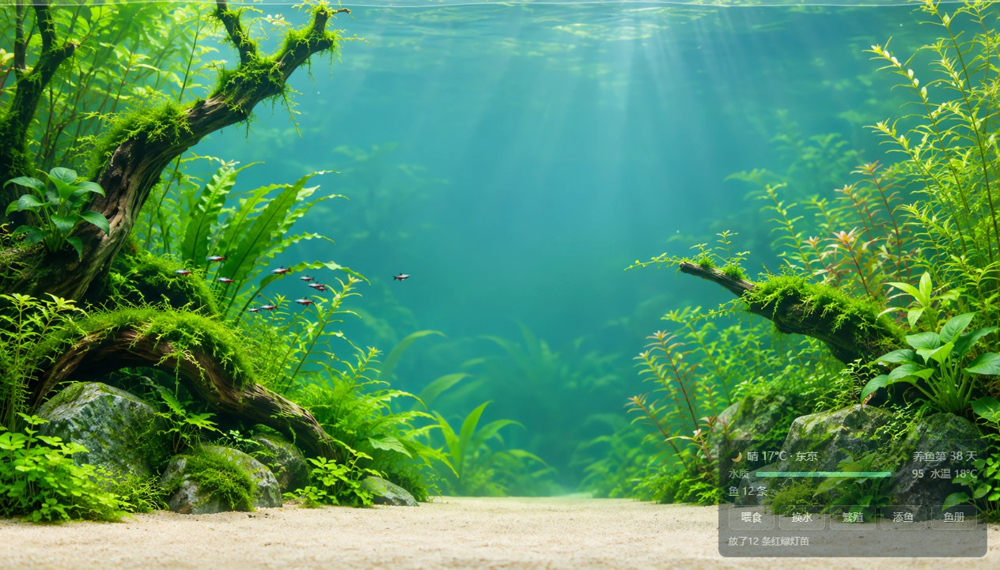

# Deskquarium · 桌面鱼池

把 Windows 桌面变成一缸会游的鱼。鱼在桌面图标后面游，要喂食、换水、繁殖，养不好会死；
时间是真实时间，天气是你所在城市当天的真实天气。



## 特点

- **就是壁纸**：挂在桌面图标后面，不挡图标、不占任务栏；桌面被窗口盖住时自动停画。
- **鱼是 3D 的**：带贴图的模型，受光照、身体会摆、掉头是真的转过来；成群的鱼会一起游，受惊会抱团窜开。
- **真的要养**：饿了会瘦、水脏了会病、老了会死；喂得勤不勤决定最后能长多大。关机时间也在走。
- **跟着真实世界走**：昼夜按日出日落渐变，晴、阴、雨、雪、雾、雷都会画出来，水温跟着气温变。
- **背景随你**：自带三张水草缸，也可以跟随系统壁纸或自选图片。

现在能养的只有红绿灯——鱼要一种一种做到逼真才放出来，见[已知边界](#已知边界)。

## 运行

需要 Windows 10 / 11 和 [Node.js](https://nodejs.org/)。没有安装包，从源码跑：

```bash
npm install          # 首次
npm start            # 或双击「启动.vbs」（不弹控制台）
npm run dev          # 普通窗口模式，不挂桌面，能拖窗口大小看自适应
npm test             # 养鱼规则的用例
```

退出：托盘里的小橙鱼 → 右键 → 退出。想开机自启就把「启动.vbs」的快捷方式放进 `shell:startup`。

> `ELECTRON_RUN_AS_NODE`：VSCode 的集成终端会注入这个变量，Electron 会退化成纯 Node。
> `scripts/launch.js` 负责剥掉它，**别把 `start` 改回 `electron .`**。

## 怎么玩

| 操作 | 怎么做 |
|---|---|
| 选鱼 | 第一次打开（或鱼缸空了）自动弹出；之后点面板「添鱼」 |
| 喂食 | 在桌面空白处点一下，饵料从那里往下沉；或点面板 / 托盘的「喂食」 |
| 换水 | 面板 / 托盘「换水」。一次去掉七成脏东西，两小时内不能再换 |
| 繁殖 | 面板 / 托盘「繁殖」。条件不够会告诉你差在哪 |
| 看鱼 | 鼠标停在鱼身上看名字、日龄、体长、饱食、健康；「鱼册」列出全部 |
| 捞死鱼 | 点浮在水面的死鱼，或在鱼册里点「捞走」。不捞会一直弄脏水，48 小时后自己烂没 |
| 换背景 | 托盘 → 背景：水草缸 / 黑水缸 / 岩组草坪缸 / 跟随系统壁纸 / 自选图片 |
| 要干净的画面 | 托盘 → 取消勾选「光影和天气效果」：背景上不再叠暗角、光柱、水纹，也不随天气、昼夜、水质变灰变暗（面板上的天气和水质照常） |
| 小夜灯 | 天黑以后右上角自动亮一盏暖黄的小灯，照亮那一角，其余地方比平常的夜色再暗一点；天亮自己灭。鱼夜里是歇着的：游得慢、停得久；亮着灯就聚到灯光边上那一片（不凑到灯底下，红绿灯怕强光），关了灯看不见同伴，群就散开各自漂。夜里受惊、喂食照样会醒。不想要：托盘 → 取消勾选「小夜灯（天黑自动亮）」。关了「光影和天气效果」时画面不随昼夜变暗，也就没有灯 |
| 藏起桌面图标 | 托盘 → 隐藏 / 显示桌面图标（和桌面右键「查看 → 显示桌面图标」是同一个开关，退出后也保持） |
| 换城市 | 托盘 → 设置城市 |

点在桌面图标上不会喂食。在鱼群旁边猛地划一下鼠标，鱼会受惊；慢慢移过去看不会。

## 规则

数值全在 [src/sim/life.mjs](src/sim/life.mjs) 的 `RULES` 和 [src/sim/species.mjs](src/sim/species.mjs) 的 `SPECIES` 里，调手感只改这两处。

- **时间是真实时间**，关机也在走：再打开时一次补算完离线的那段，结果和一直开着一样。
- **饱食**：20°C 下 36 小时从饱到空。饱食见底后开始掉健康，约 3.5 天饿死——合起来不喂约 5 天死，周末不开机没事。
- **体长**：每天向「这条鱼的极限体长」靠近一个比例。吃不饱（饱食低于 50）长得慢，低于 10 不长；
  每饿一小时，极限体长永久打一点折——**喂得勤不勤直接决定最后能长多大**。
- **喂多了**：鱼饱了就不吃，剩下的饵料沉底烂掉，每粒弄脏一点水。
- **水质**：鱼越大越多，水脏得越快。脏度过 40 拖慢生长，过 60 开始伤鱼。
- **死亡**：饿死、水脏病死、老死（过了寿命几天内）。死因写在日志和鱼册里。
- **繁殖**：同种、一公一母、成年、健康 70 以上、饱食 50 以上、水质 60 以上；产卵后歇 3 天。
  卵约一天孵出（水冷更久）。后代的底色、鳍色各随一方，色斑各有一半机会传下去，偶尔突变出一块新的。
- 鱼缸最多 24 条。

| 鱼种 | 最大体长 | 成年体长 | 寿命 | 一窝 | 习性 | 现在能养 |
|---|---|---|---|---|---|---|
| 红绿灯 | 4cm | 2.2cm（约一周） | 约 100 天 | 3 ～ 5 | 中下层，总是一群待在一起 | 是 |
| 孔雀鱼 | 6cm | 3cm（约一周） | 约 90 天 | 3 ～ 6 | 上层，松散成群，一刻不停 | 否 |
| 神仙鱼 | 15cm | 7cm | 约 180 天 | 2 ～ 4 | 中层，常悬着不动 | 否 |
| 金鱼 | 22cm | 9cm | 约 150 天 | 2 ～ 4 | 爱凑堆，老在池底啄食 | 否 |
| 锦鲤 | 70cm | 25cm（约 12 天） | 约 240 天 | 2 ～ 4 | 三三两两巡游，爱在池底翻找 | 否 |

画面上鱼的大小按体长的 0.6 次方算（照实画的话小鱼苗只剩一个点），鱼册和提示里的厘米数是真的。

## 天气

- 画面：晴天有斜射的光柱和水里晃动的光网；阴天发灰；雨点打在水面上；雪落水即化；雾天蒙一层白；雷雨会闪；
  夜里压暗，晴朗的夜里有月光。风大水面浪大。昼夜按城市的日出日落渐变。
  嫌画面发灰可以在托盘里关掉「光影和天气效果」。
- 规则：水温滞后 6 小时追气温。水冷了鱼吃得少、长得慢、也饿得慢（5°C 时是 20°C 的四成）；
  水温过 24°C 水脏得更快；下雨稀释脏水。
- 数据源：Open-Meteo，不通时换 met.no（都免费、不要 key），每 20 分钟取一次。只取「现在的天气」；
  日出日落在本地按经纬度算（[src/sim/sun.mjs](src/sim/sun.mjs)），接口挂了昼夜照常。
- 城市：默认按系统时区猜（Asia/Tokyo → 东京），**不按 IP 定位**——开着代理时 IP 定位出来的是代理出口。
  猜得不准就在托盘里设。发给天气接口的只有保留两位小数的经纬度。

## 气泡

缸里没有气泵，气泡只有两个来源：水草见了光做光合作用（光越强冒得越多，夜里不冒），和换水时带进去的那一阵。
所以背景里没有水草（系统壁纸、自选图片）就不冒泡。自带的背景图标了每丛水草的位置，见 [src/scenes.js](src/scenes.js)。

## 文件

```
src/main.js          主进程：窗口挂到桌面、转发鼠标、天气、存档、托盘。不碰鱼
src/desktop.js       Win32：挂到图标后面、轮询光标和左键、判断桌面有没有被盖住、读系统壁纸路径
src/weather.js       取天气（两个源）
src/store.js         存档与配置的读写
src/scenes.js        自带的背景：哪几张图、每张图里水草在哪
src/sim/             规则内核，纯函数，node 里直接跑用例：life（饱食 / 体长 / 健康 / 水 / 繁殖）、
                     species（鱼种、习性、花色基因）、env（天气换算）、sun（日出日落）
src/ui/              页面：app（入口）、render（画面）、motion（游动）、hud（面板）、chooser（选鱼）、
                     fish3d（有 3D 模型的鱼种，用 three.js 画）、fishpaint（没有模型的鱼种，代码逐像素画）
src/ui/fish3d/       鱼的 3D 模型（每种一个 .glb），来源和授权见 CREDITS.md
src/ui/backgrounds/  自带背景的图
scripts/launch.js    启动（剥掉 ELECTRON_RUN_AS_NODE）
scripts/pack-model.mjs   把下载来的模型（scene.gltf + scene.bin + 贴图）打成一个 .glb
test/                规则的用例
```

存档在 `%APPDATA%\deskquarium\`：`save.json`（鱼缸）、`config.json`（城市、背景、屏幕、效果开关）、
`log.txt`（画面停画和恢复、页面报错——画面不动了先看这里）。托盘里能直接打开这个目录。
`save.json` 坏了不会被当成「没有存档」覆盖掉，会挪成 `save.json.broken-<时间戳>` 留着。

## 加东西

**加一种鱼的模型**

1. 找模型（比如 Sketchfab，下载要登录）：选 glTF 格式，身体是直的、鳍展开、写实风格、面数别上十万。
   **先看授权**：CC0、CC BY 可以随代码公开；Sketchfab Standard 不允许再分发模型文件，不能进仓库。
2. 解压到 `models/<名字>/`（这个目录不进仓库）。
3. `node scripts/pack-model.mjs models/<名字>/scene.gltf src/ui/fish3d/<鱼种>.glb`
4. 在 [src/ui/fish3d.mjs](src/ui/fish3d.mjs) 的 `MODELS` 里登记：怎么摆正、体长比例、用哪段动画。
5. 在 [src/ui/fish3d/CREDITS.md](src/ui/fish3d/CREDITS.md) 里写上来源和授权。
6. 把鱼种加进 [src/sim/species.mjs](src/sim/species.mjs) 的 `STOCKABLE`，选鱼界面才会列出来。

**加一张自带背景**

图放进 `src/ui/backgrounds/`，在 [src/scenes.js](src/scenes.js) 里登记并标出水草的位置。对图的要求：
16:9、不小于屏幕分辨率、正面平视不带缸边、没有鱼、中间和上方留出开阔的水、底沙占最下面 12% 左右。

## 几个实现上的坑（别改回去）

- **新旧两种桌面布局**。Win11 24H2 起图标层留在 Progman 里，壁纸要挂成 Progman 的子窗口、夹在图标层
  （SHELLDLL_DefView）和静态壁纸（子 WorkerW）之间，并且窗口必须带 `WS_EX_LAYERED`；老系统是挂进图标层后面那个顶层
  WorkerW。`desktop.js` 的 `findDesktop` 两种都认。实测的是新布局（26300），**老布局那条分支没有机器验过**。
- **`SetWindowPos` 要带 `SWP_NOSENDCHANGING`**，窗口要 `thickFrame: false`。否则 Chromium 把无边框窗口的高度压回
  工作区、还留 8px 隐形边，任务栏后面露出一条旧壁纸。
- **鼠标**：壁纸在图标层后面，一个鼠标消息也收不到。主进程每 30ms 看光标和左键，把「移动」「点击」经 IPC 发给页面，
  页面用 `elementFromPoint` 自己判断点的是按钮还是水。所以页面里的按钮一律用 `data-act`，**不要绑 click 事件**
  （挂在桌面上时不会触发）。
- **分辨「点图标」和「点水面」**：点完问图标层「现在选中了几个图标」（`LVM_GETSELECTEDCOUNT`）——点在图标上会选中它，
  点在空白处会清空选择。不用跨进程做 `LVM_HITTEST`。
- **桌面被盖住就停画**：关掉了 `CalculateNativeWinOcclusion`，自己看前台窗口（`watchCovered`，一秒十次）。三处细节：
  - 查得慢的话，切回桌面的那一下画面会先定住再动，看着像卡了一下。
  - Alt+Tab、任务视图这些系统浮层会铺满全屏、也会当前台窗口，但它们是透明的，**不能算盖住**
    （`desktop.js` 的 `SHELL_OVERLAYS`）。漏了的话人看着桌面、画面却停着。
  - 兜底：光标正指着桌面，就一定没被盖住。
  盖住时鱼照样在长在饿（每 5 秒推进一次规则），只是不画。
- **整屏的底图要转成 `ImageBitmap` 再每帧贴**。直接拿 `OffscreenCanvas` 去 `drawImage`，每帧都要把整屏像素重新传一遍，
  实测显卡进程吃掉半个核。
- **有模型的鱼是 3D 的**（`fish3d.mjs`）：画在一张透明的 WebGL 画布上，`render.mjs` 每帧把它贴进 2D 画面。
  three.js 装在 node_modules 里，`index.html` 里有一张 importmap 告诉页面去哪找它；页面的安全策略不许内联脚本，
  所以 importmap 的 sha256 写在了 Content-Security-Policy 里——**改 importmap 的内容要重算这个 sha256**。
  模型文件页面自己读不了（本地文件页面不能 fetch），由主进程读了经 `host.asset` 递过去；
  模型里内嵌的贴图同理不能用 fetch 读，`fish3d.mjs` 的 `parse` 里有一处绕法，注释写了原因。
- **没有模型的鱼是贴图**：每条鱼的侧面像做一次存成贴图（体长每涨 25% 重做一张，一帧最多做两张），
  游动时把贴图切成竖条错开来贴；每条竖条按摆动的斜率斜切，相邻两条的边才接得上，不然轮廓有台阶。
- 帧率锁在约 30：这是壁纸，不值得跟着高刷屏烧显卡。

## 开发参数

只在给了 `--save-dir` 时才认（不动真存档）：

```
--window                 普通窗口模式
--save-dir=<目录>        存档放到别处
--demo                   没有存档时直接给一缸大小不一的鱼
--weather=clear|partly|cloudy|fog|drizzle|rain|snow|thunder   指定天气（不联网）
--light=<0~1>            指定亮度（0 是深夜）
--fast=<倍数>            时间加速
--shot=<png> --shot-after=<毫秒>   截一张图就退出
--poke=<x,y;x,y>         隔一秒模拟点一下（不动真鼠标）
--always-draw            桌面被盖住也照画（量性能用）
--plain                  背景上什么都不叠（等于关掉「光影和天气效果」）
```

## 已知边界

- **现在只能养红绿灯**。鱼要看着像真的，得用 3D 模型：图片试过三版（矢量填色、逐像素算光照和鳞片、真鱼照片抠图），
  放进鱼缸都是一眼贴图——光是死的、只有一个姿势、掉头像翻纸片。所以选鱼界面只列做好了模型的鱼种
  （`species.mjs` 的 `STOCKABLE`），做好一种加一种。其余四种的规则和习性都在代码里，画法还是代码画的贴图，只是不让选。
- 红绿灯的鱼苗是缩小的成鱼，没有单独的幼鱼样子。
- 习性只有红绿灯的成群在画面上验过；其余几种的数值是照真鱼的脾气填的。没有「趴在池底不动」这种行为，等养到底栖的鱼再加。
- 性能数字没有：换成 3D 之后没有重新量过占用。
- 只铺一块屏幕（多屏时托盘里选哪块），不跨屏。
- explorer 重启后会自动重新挂上（每秒检查一次），这条没实测过。
- 长假不开机鱼会饿死，目前没有自动喂食器。
- 只在 Windows 11（26300）测过。没有安装包，没有签名。

## 素材和依赖

- 红绿灯模型：[Paracheirodon Innesi _ Tetra Neon](https://sketchfab.com/3d-models/paracheirodon-innesi---tetra-neon-2fabf5db754746b7b81ebfa0bbe99161)，
  作者 BlueMesh，[CC BY 4.0](http://creativecommons.org/licenses/by/4.0/)。详见 [CREDITS.md](src/ui/fish3d/CREDITS.md)。
- 三张自带背景是 AI 生成的图。
- [Electron](https://www.electronjs.org/)、[three.js](https://threejs.org/)、[koffi](https://koffi.dev/)（调 Win32）。
- 天气数据：[Open-Meteo](https://open-meteo.com/)、[MET Norway](https://api.met.no/)。
